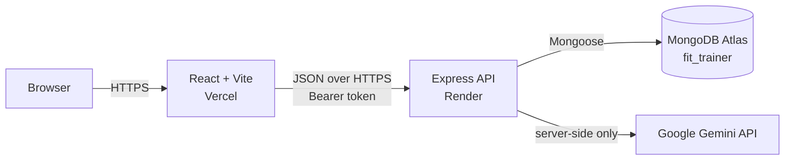
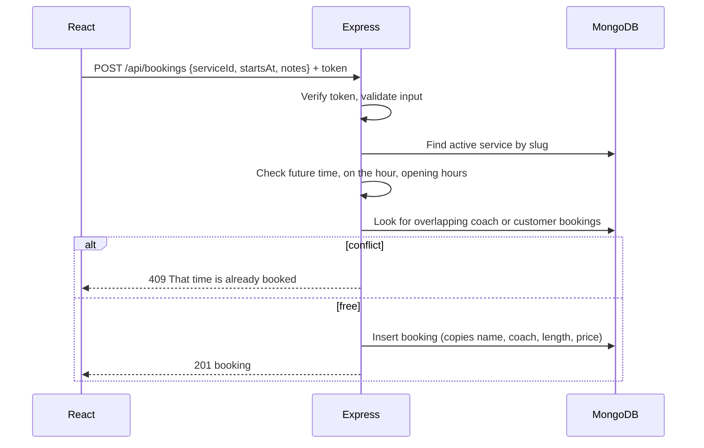

# Fit Trainer

AI-powered booking platform for one-on-one personal training sessions.

- **Live site:** https://trainer-gym.vercel.app
- **API:** https://fit-trainer-api.onrender.com/api
- **Health check:** https://fit-trainer-api.onrender.com/api/health
- **Repository:** https://github.com/antoniogonzalez1415/trainer-gym

## Overview

Booking a personal trainer often means phone calls, messages and guessing which session fits. Fit Trainer lets customers browse sessions, describe a goal and get suggested sessions, book a time, and manage their bookings in one place.

**Target users:** adults who want personal training (beginners to advanced) and need a simple way to choose and book sessions. This version has one role: customer.

## Features

- Browse 11 active sessions and filter by category (Strength, Cardio, Mobility, Flexibility, Running, Assessment)
- Session detail page with coach, length, level and price
- Account registration, login and logout (passwords hashed with bcrypt, JWT authentication)
- Book a session at a future time, on the hour, between 6:00 and 19:00 (America/Chicago)
- Conflict prevention: a coach cannot have overlapping sessions, and neither can a customer
- Dashboard with next session, upcoming count, minutes planned, and past/cancelled history
- Reschedule or cancel upcoming bookings (cancelling keeps the record)
- AI goal assistant that recommends up to three real sessions
- Responsive layout from phone to desktop, visible keyboard focus, labelled forms

## AI feature: goal assistant

On the home page, a visitor writes a training goal, such as "I sit at a desk all day and want to feel less stiff". The backend:

1. Validates the goal (5 to 300 characters) and applies a rate limit.
2. Loads the active sessions from MongoDB.
3. Sends Google Gemini only the session facts it needs and the goal, with instructions to treat the goal as data, choose only real session ids, and avoid medical advice.
4. Requests structured JSON whose `serviceId` values are limited to real session slugs.
5. Validates the answer again and attaches name, length and price from MongoDB, never from the model.
6. Falls back to keyword matching if no API key is set or the provider fails or times out (15 seconds by default, `AI_TIMEOUT_MS`).

**Limitations:** suggestions are informational and can be imperfect. The assistant never books anything; the customer reviews a real session and confirms the booking. It does not give medical, injury or nutrition advice. Goals are not stored. On Gemini's free tier, Google may use submitted text to improve its products, so the page asks users not to enter personal or medical details.

## Architecture

Three tiers: React (presentation) → Express API (application) → MongoDB Atlas (data). The AI provider is called only by the backend, so the API key never reaches the browser.



Booking creation:



## Technology

| Layer | Tools |
|---|---|
| Frontend | React 19, Vite, React Router |
| Backend | Node.js 22+, Express 5, Mongoose 9 |
| Database | MongoDB Atlas |
| Security | bcryptjs, jsonwebtoken, helmet, cors, express-rate-limit |
| AI | Google Gemini API over HTTPS (no SDK) |
| Hosting | Vercel (frontend), Render (backend) |

## Folder structure

```
trainer-gym/
├── frontend/
│   ├── src/
│   │   ├── api/client.js        One place that calls the backend
│   │   ├── components/          Navbar, ServiceCard, GoalAssistant, TimeFields...
│   │   ├── context/AuthContext  Logged-in user and token
│   │   ├── hooks/useApi.js      Loading, error and data for GET requests
│   │   ├── pages/               Home, Services, ServiceDetail, Login, Register, BookService, Dashboard
│   │   └── utils/dates.js       Local time <-> ISO 8601
│   └── vercel.json              Sends every route to index.html
└── server/
    ├── src/
    │   ├── config/              Environment variables and MongoDB connection
    │   ├── controllers/         What each endpoint does
    │   ├── middleware/          Auth, rate limits, 404, error handler
    │   ├── models/              User, Service, Booking schemas
    │   ├── routes/              URL to controller mapping
    │   ├── services/            Booking rules and AI recommendation logic
    │   ├── validators/          Request input checks
    │   ├── app.js               Express setup
    │   └── server.js            Connects to MongoDB, then starts listening
    ├── scripts/                 Seed data, model checks, API smoke test
    └── postman/                 Postman collection
```

## Run locally

**Prerequisites:** Node.js 22 or newer, a MongoDB Atlas cluster and database user, optionally a Gemini API key.

```bash
git clone https://github.com/antoniogonzalez1415/trainer-gym.git
cd trainer-gym

# Backend
cd server
npm install
cp .env.example .env        # Windows: Copy-Item .env.example .env
# Fill in .env (see below)
npm run seed                # Loads the 11 sessions (safe to repeat)
npm run dev                 # http://localhost:5000/api/health

# Frontend (second terminal)
cd frontend
npm install
npm run dev                 # http://localhost:5173
```

## Environment variables

Names only. Real values live in `server/.env` locally and in the hosting dashboards in production. Never commit them.

| Variable | Where | Secret | Purpose |
|---|---|---|---|
| `PORT` | backend | no | Port to listen on (set by Render in production) |
| `NODE_ENV` | backend | no | `development` or `production` |
| `MONGODB_URI` | backend | **yes** | Atlas connection string |
| `MONGODB_DB_NAME` | backend | no | `fit_trainer` |
| `CLIENT_ORIGIN` | backend | no | Allowed frontend origin(s) for CORS |
| `JWT_SECRET` | backend | **yes** | Signs login tokens (32+ random characters) |
| `JWT_EXPIRES_IN` | backend | no | Token lifetime, e.g. `1d` |
| `STUDIO_TIMEZONE` | backend | no | `America/Chicago` |
| `AI_PROVIDER` | backend | no | `gemini` |
| `AI_MODEL` | backend | no | Gemini model id, e.g. `gemini-3.5-flash-lite` |
| `AI_TIMEOUT_MS` | backend | no | How long to wait for the AI before using the fallback (default 15000) |
| `AI_API_KEY` | backend | **yes** | Gemini API key (optional; fallback without it) |
| `VITE_API_BASE_URL` | frontend | no | Backend URL ending in `/api`. Public: it is built into the site |

## API summary

| Method | Path | Auth | Description |
|---|---|---|---|
| GET | `/api/health` | – | API and database status |
| GET | `/api/services?category=` | – | Active sessions |
| GET | `/api/services/:id` | – | One session by slug |
| POST | `/api/auth/register` | – | `{name, email, password}` → `{token, user}` |
| POST | `/api/auth/login` | – | `{email, password}` → `{token, user}` |
| GET | `/api/auth/me` | Bearer | Current user |
| POST | `/api/bookings` | Bearer | `{serviceId, startsAt, notes}` → booking |
| GET | `/api/bookings/mine` | Bearer | Customer's bookings |
| GET | `/api/bookings/:id` | Bearer | One own booking |
| PATCH | `/api/bookings/:id` | Bearer | `{startsAt}` reschedule |
| DELETE | `/api/bookings/:id` | Bearer | Cancel (status becomes `cancelled`) |
| POST | `/api/ai/recommend-service` | – (rate limited) | `{goal}` → recommendations |

Errors use one shape: `{ "error": "Validation failed", "details": [{ "field": "email", "message": "..." }] }`. Status codes: 400 invalid input, 401 not logged in, 404 not found (including other customers' bookings), 409 conflict, 429 too many requests, 500 unexpected error (no internal details shown).

## Testing

```bash
cd server
npm run check:models   # Schema rules, no database needed
npm run test:api       # 48 checks against the running API: workflow, validation, auth, ownership, conflicts, AI
```

Against production (PowerShell): `$env:API_URL="https://fit-trainer-api.onrender.com/api"; npm run test:api`

Postman: import `server/postman/FitTrainer.postman_collection.json` and run it top to bottom.

The smoke test creates users named `smoke-...@example.com`; delete them in Atlas when no longer needed.

## Deployment

1. **MongoDB Atlas:** database user `fit_trainer_app` with `readWrite` on `fit_trainer` only. Network Access allows the backend host.
2. **Render (backend):** Web Service `fit-trainer-api` from this repository, root directory `server`, build `npm install`, start `npm start`, environment variables above with `NODE_ENV=production` and `CLIENT_ORIGIN=https://trainer-gym.vercel.app`.
3. **Vercel (frontend):** project `trainer-gym`, root directory `frontend`, Vite preset, output `dist`, `VITE_API_BASE_URL` set to the Render URL plus `/api`. `vercel.json` rewrites every route to `index.html` so refreshing `/dashboard` works.

The free Render plan sleeps after inactivity, so the first request can take up to a minute.

All 48 API checks pass against the deployed API, including the AI recommendation (`source: ai`).

## Screenshots

_Add screenshots of: home with AI suggestions, sessions list, session detail, booking form, dashboard, mobile view._

## Known limitations

- Two bookings sent at the exact same moment could both pass the conflict check; a production system would use a transaction or a unique time-slot index.
- The free Render instance sleeps after about 15 minutes without traffic; the first request afterwards can take up to a minute.
- Opening hours are fixed (6:00–19:00 Chicago) and coaches have no individual schedules or days off.
- One role only (customer); sessions are managed with the seed script, not an admin screen.
- The login token is kept in localStorage, which is simple but readable by injected scripts; an HttpOnly cookie would be safer.
- No email confirmations or payments.

## Future improvements

- Admin dashboard for sessions and coach availability
- Email reminders and calendar invites
- HttpOnly cookie sessions and refresh tokens
- Automated tests in CI

## Responsible AI use

- The AI only recommends; it cannot create, change or confirm bookings.
- Answers are limited to real sessions and checked again on the server.
- Customer goals are not stored or logged; the model never receives account data.
- A clear disclaimer is shown with every suggestion, and the app still works without AI.
- AI tools also assisted development. All generated code was reviewed, run and tested. Examples:
  - A deprecated Mongoose `validateSync()` call was replaced with `validate()` after the library printed a deprecation warning.
  - The first Gemini model timed out (server log: `TimeoutError`); switching to `gemini-3.5-flash-lite` and a configurable timeout fixed it.
  - The first production deploy was blocked by CORS; the browser console showed the real Vercel origin, and `CLIENT_ORIGIN` was corrected.
  - Secrets that appeared in screenshots during development were rotated before deployment (database password, AI key, JWT secret).

## Photo credits

_Session photos are free-licensed images from Pexels/Unsplash. Add each photographer here, for example: `hero.jpg` – Photo by NAME on Pexels._

## Author

Antonio Gonzalez – [GitHub](https://github.com/antoniogonzalez1415)
